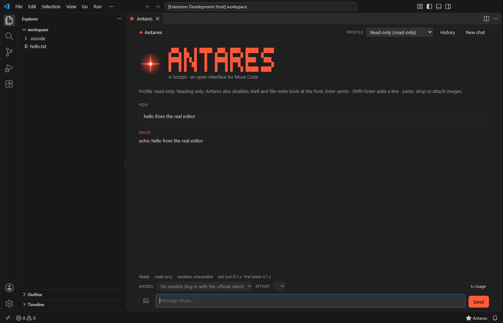
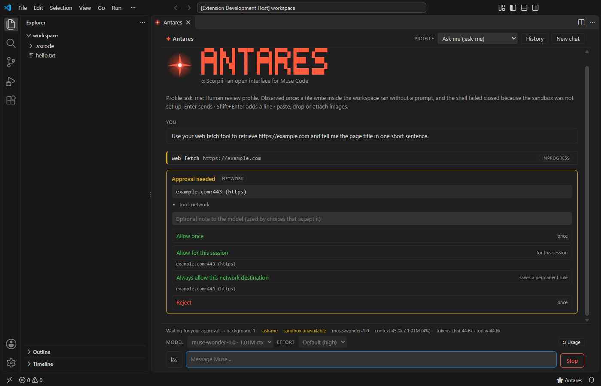

<p align="center">
  
</p>

<p align="center">
  <br>
  <sub>Antares in VS Code (offline echo provider, throwaway profile).</sub>
</p>
<p align="center">
  <br>
  <sub>A real approval request from Muse (network access), with the host's own choices.</sub>
</p>

```text
 ███  █   █ █████  ███  ████  █████  ████
█   █ ██  █   █   █   █ █   █ █     █
█████ █ █ █   █   █████ ████  ████   ███
█   █ █  ██   █   █   █ █  █  █         █
█   █ █   █   █   █   █ █   █ █████ ████
```

α Scorpii · an open interface for Muse Code by [Antonio Rafael Souza Cruz de Noronha](https://www.antoniorafael.com.br/)

**Antares** is an open-source editor interface for Muse Code, for VS Code and VS Code–based editors such as Antigravity. It talks to your locally installed `muse` through its official Muse Server Protocol (MSP), so Muse keeps doing the login, the model calls and the sandboxing. Antares only gives it a friendlier place to live.

> **Status: release candidate 0.2.0.** Chat with streaming, tool cards, approvals with the host's own choices, five permission modes, voice input (Windows), a composer "+" menu (files, folders, skills, connectors, plugins, queue), file-edit diffs with a cumulative Changes view, images from the workspace, Computer Use approval cards, a model catalog that follows your plan, a Standard/Contributor indicator, a **skills manager**, an **MCP manager**, a **plugin and marketplace manager**, web-access switches and a page **Preview** work and were checked in VS Code and Antigravity IDE. Several things could not be verified with a real model, a real browser server, a real OAuth provider or a working sandbox on the test machine; every such limit is listed in the [roadmap](#roadmap) and in the docs.

> **Having trouble?** "sandbox unavailable", shell commands failing: see [docs/SANDBOX.md](docs/SANDBOX.md). Voice setup: [docs/VOICE.md](docs/VOICE.md). Browser and app control: [docs/BROWSER.md](docs/BROWSER.md). What the protocol does and does not allow, as measured: [docs/PROTOCOL-NOTES.md](docs/PROTOCOL-NOTES.md).

> **Unofficial.** Antares is an independent community project. It is not made, endorsed or supported by Meta or the Muse Code team. "Muse" and "Muse Code" belong to their owners.

## Why "Antares"?

Every project of the author is named after a star. Antares (α Scorpii) is the red supergiant at the heart of the constellation Scorpius. Its name comes from the Greek *Anti-Ares*, "rival of Mars", because its color is so close to the red planet's. A bright, red, easy-to-find light in a crowded sky, which is roughly what an agent interface should be.

## What Antares does and does not do

- It **launches the official `muse serve`** as a child process and speaks MSP (JSON-RPC 2.0, one JSON object per line over stdio).
- It **does not** read your `auth.json`, call the key-minting endpoint, or call the model API on its own. Your subscription stays attached to the official client; login happens through the host (device code flow) when that phase lands.
- It **starts every chat in Plan mode**, which is Muse's `:read-only` profile, with shell and file-write tools also disabled at the host. You choose another mode with the selector next to the model picker (setting `antares.initialProfile` sets the starting profile). Anything above Plan asks for confirmation that says what it grants, and the chat continues under the new profile instead of starting over. The mode and the sandbox state the host reports are always shown. Antares never decides an approval by itself.
- **The modes are Muse's profiles, named for what they do:** Auto is `:auto-review`, Accept edits is `:ask-me` (workspace edits run without asking; shell, network and other restricted actions ask), Plan is `:read-only`, Bypass permissions is `:unrestricted` (no sandbox, no prompts; never reached by Shift+Tab). **Manual (ask before every edit) is not offered**, because Muse has no such profile; Antares says so instead of pretending.
- **A ready sandbox check is not an active sandbox.** In testing, `muse sandbox windows check` said `ready` while `muse serve` reported the sandbox unavailable and the shell tool failed closed. Antares shows what the host reports for the session.
- It **does not bundle or redistribute** Muse or its schemas. Protocol types are generated from the `muse` you have installed (`muse schema generate-json-schema`).

## Roadmap

| Phase | Scope | Status |
|---|---|---|
| 0 | MSP client, offline self-test (echo provider), Antares panel with banner | **Done** |
| 1 (MVP) | **Done:** chat with streaming, copy button on every message and code block, paste text, startup banner, usage/context/token footer, tool-call cards, approval cards (decide with the host's own choices), permission profile per chat with a confirmation for anything above read-only, model and reasoning-effort picker (catalog shown before the first message, choice remembered), image input (paste, drop or the + menu; PNG verified against the real host), subscription usage (5 h and weekly windows with "as of", threshold alerts, status bar, local token ledger), session history (continue or fork a stored session of the open folder, with the conversation redrawn). **Phase 1 feature list complete and checked in the real editors, including real approvals.** Not yet seen: file-access and Unix-socket approvals, multi-stage approvals from the real host (handled and tested against a fake one), and `:auto-review`. | **Done** (protocol findings: [docs/PROTOCOL-NOTES.md](docs/PROTOCOL-NOTES.md)) |
| 2A | **Done (Windows):** voice input. Microphone button, **local** transcription with faster-whisper (recommended) or Windows speech recognition; the text lands in the box for review and nothing is sent by itself. See [docs/VOICE.md](docs/VOICE.md). Recording on macOS and Linux is not implemented yet | **Done** |
| 2B | **Done:** composer "+" menu. Add files or photos (Ctrl+U), the current file, the selection, files dragged from the Explorer (photos attach, other files become `@path` mentions because Muse has no file part), add a folder (asks first), slash commands from Muse's own skills (`/` opens the palette), read-only lists of connectors and plugins, **Import skills…** (copy skills from Claude's or Codex's folders into Muse: shows the host's preview first and changes nothing until you confirm), and a queue: while a turn runs, Enter steers it and Ctrl+Enter queues the message (with a Remove button). Managing connectors and plugins is 3A | **Done** |
| 2C | **Done, with one limit:** permission mode selector (Auto, Manual, Accept edits, Plan, Bypass permissions) next to the model picker. Shift+Tab cycles, 1 to 5 pick in the open menu, and switching **continues the same conversation** under the new Muse profile. **Manual is shown as unavailable**: Muse has no profile that asks before every edit (observed: a workspace write ran without a prompt even in its strictest prompting mode) | **Done** |
| 3A | **Done, with limits:** connectors (list, **OAuth sign-in and sign-out** run by Muse; Antares never sees a credential), plugins (list, **install from a folder** after Muse's own read-only validation shows what the bundle brings, **install from a marketplace**, **add a marketplace**, each with a dialog that says what it does and asks first; Antares never approves what a plugin brings) and skills (import with preview). **Not possible over MSP:** adding or removing an MCP server, uninstalling or toggling a plugin, reading a skill's activation. Sign-in was only tested against a fake host (no connector on the test machine) | **Done** |
| 3B | **Done as far as Antares can go:** browser and app control is an MCP server *you* configure in Muse (the protocol cannot add one). Antares shows the tool calls, lists a tool approval's arguments as `name: value` lines and renders **Computer Use approvals** (page host with its plain form when non-ASCII, window title as plain text, every step, masked data). See [docs/BROWSER.md](docs/BROWSER.md) for what is known, an untested config shape and the safety advice. No real browser server or Computer Use request was run | **Done** |
| 3C | **Done as far as the host allows:** images from the workspace are shown. A `read_file` of an image shows the file's thumbnail on its card, and `` in an answer shows the file when it is in the workspace (read by the extension: no URL is ever fetched; PNG, JPEG, GIF and WebP only, up to 5 MB, bytes checked; a refused image says why). **The image a model saw through a tool is not exposed by Muse** (measured), and **model-generated images have no support in the contract** | **Done** |
| 3D | **First slice done:** tool presentation. `write_todos` is a checklist; `write_file` and `edit_file` show the file, the `+n −m` counts and an inline diff built from Muse's own patch, with **Open diff** (VS Code's diff editor, before and after) and **Open file**. A **Changes (n)** button lists every file changed in the chat once and opens one diff per file from before the first edit to now. **Worktrees could not be built or tested here** (the host's own git probe times out on the test machine) and an **embedded terminal was left out on purpose** (it would re-run what the agent ran, under other permissions) | **Done, with limits** |
| 4 | **Video input: not built.** The contract is understood (`media/upload` in base64 chunks of `video/mp4` or `video/quicktime`, then a `video` part; needs a durable session; the host validates the total and the type and rejected a synthetic file at finalize), but it could not be tested end to end without a real video and a paid turn, and shipping it blind would be a guess. Packaging is ready (see CHANGELOG); publishing to Open VSX and the Marketplace needs the author's accounts and tokens | **Release candidate** |
| 5A | **Done:** model catalog and plan. The picker comes from Muse (`model/list`); a failed refresh keeps the last list and says it may be out of date; a **↻ Models** button; a notice when the catalog changes or the remembered model is gone; the list is read again when your plan name changes or the window returns to the front. The host does not return models your account cannot use, so nothing is shown as "locked". |
| 5B | **Done:** usage mode. A read-only **Standard / Contributor** indicator that says "not confirmed" whenever the saved setting does not prove what is in effect, a privacy explanation, and a confirmed switch **to Standard only** (turning Contributor on is done in Muse itself, which records your acknowledgement). |
| 5C | **Done:** skills manager ("+" > Manage skills). Scope, origin, **real on / user-invocable-only / off state** (read from `muse skills --json`, written and read back), search and filters, name-clash warnings, install from a folder (validated first) and remove, import with preview. Installing from a Git URL is not offered by Muse. |
| 5D | **Done:** MCP manager ("+" > Connectors). Lists the servers in Muse's `settings.json` (the host's own list does not show them), add / edit / switch off / remove with confirmation, backup and atomic write, secrets never shown, and a **Test** that makes Muse itself start one server in a clean config. A tool call through a settings-defined server was proven end to end with a real turn. |
| 5E | **Done:** plugins and catalogs. What each plugin brings and the **review state of its hooks and MCP servers** (never approved automatically; each part has its own Approve/Reject), enable / disable / update / remove, a marketplaces view, **suggested catalogs** (Anthropic's official plugin marketplace and Agent Skills collection, offered once, never added silently) and your own marketplaces. |
| 5F | **Done:** web and preview. A **Web** indicator and switches for Muse's `web_fetch` and `web_search`; a **Preview** button that opens a local dev server, an address or an HTML file of the folder (served read-only on 127.0.0.1) in the editor's own browser. |
| 5G | **Blocked by Muse:** Muse Image. There is no image-generation method, event or tool in the protocol; the documented way is a separate API with a key and per-image billing, which Antares does not integrate. See [docs/EVOLUCAO.md](docs/EVOLUCAO.md). |

Details, decisions and open questions: [docs/PLAN.md](docs/PLAN.md) (in Portuguese for now).

Known limits worth stating up front:

- Sessions: you can continue or fork stored sessions of the open folder (others are listed but cannot be opened from here). Renaming is not offered because the host does not support it on Windows. A fork cannot be given a permission profile, so forking is only offered in Read-only chats; a resumed session always gets the profile you chose, never the one it had. Very long sessions may not be replayed inline; Antares then continues them and says so.

- Muse accepts `text`, `image`, `skill` and `video` as turn input. There is no audio part, so voice is transcribed on your computer and the text goes to the message box.
- **The sandbox.** In Accept edits and Auto, Muse runs shell commands inside its sandbox. On Windows that needs a one-time setup (`muse sandbox windows setup`, from an administrator terminal) that Antares never runs for you. Without it Muse reports the sandbox as unavailable: shell commands fail before they start while file reads and edits still work, and Antares says so under the mode selector and on the failed tool call. `muse sandbox windows check` can say "ready" while `muse serve` reports unavailable (observed), so trust the footer's "sandbox" label, which is what the running host reports. Plan never runs commands; Bypass permissions runs them without a sandbox.
- The "+" menu: a file **outside** the workspace cannot be mentioned (Muse's file tools refuse it), so use *Add folder* first; that is a grant of access, so it asks, says it does not grant Project Trust, applies from the next message and ends with the chat. The host wants canonical paths for added folders (Antares converts them). It is **not yet verified with a real model turn** that the agent reads inside an added folder, nor how Muse treats an `@path` with spaces (Antares quotes it). `/name args` is sent as a skill only when the name is in Muse's own list; anything else is plain text. Connectors and plugins are read-only lists for now.
- Voice: audio never leaves your machine and the temporary recording is deleted after transcription. **faster-whisper is the recommended engine** (run *Antares: Set up local voice* once; it asks before downloading anything and needs a Python 3.9+ you already have; plan for about 450 MB with the default `base` model, in a folder you can choose with `antares.voice.home`). *Windows speech recognition* is the alternative with no download, but it needs a desktop speech recognizer installed for your language. Recording is Windows-only for now, and is done by the extension host because the editors' webviews deny the microphone. Details and measurements: [docs/VOICE.md](docs/VOICE.md).
- Images: PNG was verified end to end against the real host; JPEG, GIF and WebP follow the contract but were not tried. The host's own size limits are unpublished, so Antares applies its own (6 images, 5 MB each, 5.5 MB total (the host refuses requests above about 8 MiB; larger pictures are re-encoded as JPEG to fit), scaled to 2048 px on the long side). Dropping files onto a webview may require holding Shift in VS Code; that has not been checked.
- Subscription usage is exposed as percentages of the 5 h and weekly windows. There is no monetary figure in the protocol, so Antares will not invent one. The numbers are as of the host's last read, not live: Antares shows the time, reads fresh numbers when a chat opens (`usage/refresh`, no model call, at most once a minute; setting `antares.usage.refreshOnOpen`) and after each message, and never polls. Alerts (default 80% and 95%, setting `antares.usage.alertThresholds`) fire once per window and re-arm when the window resets. The token counter is a local sum of what the host reports for chats run through Antares, not the account total.
- Part of the protocol is experimental and may change between Muse versions. Antares checks the schema fingerprint at `initialize` and warns when it differs from the versions it was written against.

## Install and first use

Full guide: **[docs/INSTALL.md](docs/INSTALL.md)** (English) · **[docs/INSTALL.pt-BR.md](docs/INSTALL.pt-BR.md)** (Português).

1. **Have Muse Code installed and logged in** (`muse --version`, then `muse login` once). Open your project folder in VS Code or Antigravity IDE.
2. **Download `antares-0.2.0.vsix`** from the [Releases page](https://github.com/Ald3b4r4n/antares/releases).
3. **Install it:** Extensions view, the `...` menu, *Install from VSIX...* (or `code --install-extension antares-0.2.0.vsix`), then *Developer: Reload Window*.
4. **Open it:** click the Antares icon in the activity bar, or `Ctrl+Shift+P`, then *Antares: Open*. If it says "Muse executable not found", set `antares.musePath`.
5. **Optional voice:** `Ctrl+Shift+P`, then *Antares: Set up local voice* (about 450 MB, asks first, runs on your computer).
6. **Use it:** pick a mode next to the model (Plan reads only; Accept edits edits files; Bypass runs commands with no sandbox), use `+` to add files, folders, skills and more, and watch the footer for your subscription usage.

If shell commands fail with "sandbox unavailable", read [docs/SANDBOX.md](docs/SANDBOX.md).

### What is still missing in 0.2.0

Video input, worktrees, voice recording outside Windows, an embedded terminal, **Muse Image** (no protocol support), the agent *controlling* a browser by itself (that needs a browser MCP server you configure), installing skills straight from a Git URL, publishing to Open VSX and the Marketplace, and verification with real services (connector OAuth against a real provider, a third-party plugin, the Auto-review reviewer). Each has a reason in [docs/INSTALL.md](docs/INSTALL.md#10-what-is-still-missing-in-020) and in the [roadmap](#roadmap).

## Requirements

- Muse Code installed and, for later phases, logged in. Phase 0 needs no login.
- VS Code 1.90+ or a compatible fork. Tested inside **VS Code 1.143.1** and **Antigravity IDE 1.107.0**, including a real-window check (see [Testing](#testing)). The protocol layer and the chat core are also tested headless on Windows against Muse 1.4.14.
- Node.js 22+ to build from source.

## Try it (from source)

```bash
npm install
npm run typecheck
npm run build

# headless self-test of the protocol layer (no login, no model call)
npm run spike

# chat core against the offline echo provider (no login, no model call)
npm run smoke

# open the real chat UI in a browser with a FAKE Muse host (no Muse process, no cost)
npm run preview   # then visit http://127.0.0.1:5757/
```

The self-test starts `muse serve --provider echo --no-session-log --sandbox-network restricted` with an isolated config tree and no credentials, performs the MSP handshake, opens one ephemeral session, and closes the host. Expected output ends with `"ok": true`.

To run inside the editor, open this folder in VS Code and press `F5`, then run **Antares: Open** from the command palette. If `muse` is not on your `PATH`, set `antares.musePath` in Settings.

To install in Antigravity or another fork, build a VSIX with `npm run package` and install it with *Extensions: Install from VSIX…*.

## Testing

```bash
npm run test:editor -- "<path to the editor executable>" vscode
```

This opens the editor with Antares loaded as a development extension in a throwaway profile, with the offline `echo` provider and an isolated Muse config (no login, no model call), and runs `test/suite` inside its real extension host. It checks that the webview loads and runs under the editor's CSP, that a turn streams and renders, that the copy buttons exist, that copying reaches the host clipboard, and that *New chat* restarts cleanly. 
### Real-window check

```bash
node scripts/e2e-editor.mjs "<path to the editor executable>" vscode
```

This launches the editor for real, with Antares loaded as a development extension in a throwaway profile (offline `echo` provider, isolated Muse config, no login, no model call), connects to it over the Chrome DevTools Protocol, opens the panel from the command palette, drives the **real webview** and saves screenshots of the real window to `spike-output/e2e/`. It checks 32 things (the number grows with each phase), among them: the banner and logo load through the webview URI; a message round-trips; the copy button reaches the clipboard through the extension host; real key events (Enter sends, Shift+Enter does not); a pasted image shows its thumbnail under the real Content-Security-Policy and is sent; changing the profile asks for confirmation in the editor's own dialog and restarts the chat; the history panel answers; the + menu opens, files become mentions, a folder asks before it is added, the slash palette lists the real host's skills and a typed /skill is accepted, and the connector and plugin lists answer; the status bar item exists; and the panel does not overflow when narrow (down to about 220 px). It found two real problems that the browser preview and the headless tests had not: an unreadable banner and a layout that overflowed in narrow panels. Passing on VS Code 1.143.1 and Antigravity IDE 1.107.0. On the first run, Antigravity IDE shows a welcome screen; the script only presses its plain "Get Started" button and never signs in.

With `E2E_REAL=1` it instead uses your own Muse login and runs a **real model turn that triggers a real approval** in the real window (`E2E_DECISION=allow` allows one fetch of `example.com` and nothing else; `E2E_DECISION=reject` rejects everything, with a note). It costs a real turn each time, and it starts your configured hooks. Both decisions passed every approval check on VS Code 1.143.1 (the one other failure on the first run was a wrong expectation about the status-bar text, since fixed).

With `E2E_MODES=1` it uses the real `muse serve` of your machine in an isolated config (no login, **no model call**): it opens a session and switches the permission mode through the real UI, checking that the session continues under the new profile (Plan to Accept edits with its confirmation, Shift+Tab back, and Bypass asking and being cancelled). Passing on both editors.

Not covered: dropping files from the operating system onto the panel, and file-access, Unix-socket and multi-stage approvals from the real host.

## Project layout

```text
src/muse/host.ts      JSON-RPC client over the stdio of `muse serve`
src/muse/session.ts   one chat session over one host (turns, interrupt, approval relay, profile)
src/muse/events.ts    maps raw MSP notifications to the events the UI shows
src/muse/usage.ts     alert thresholds, token ledger, one-shot usage refresh
src/muse/images.ts    image input validation and turn input parts
src/muse/localImages.ts workspace images shown in the chat (strict checks, read by the extension)
src/muse/patches.ts   the host's file-edit patches: safe reading, rebuilding the before side
src/muse/modes.ts     the permission modes and the Muse profile each one maps to
src/muse/composer.ts  the + menu: skills, @mentions, canonical roots, plugin and connector rows
src/muse/mcp.ts       connector list on a short-lived experimental host
src/muse/mcpLogin.ts  OAuth sign-in and sign-out for connectors (the host owns the credential)
src/muse/pluginCli.ts Muse's read-only plugin questions: validate a bundle, list available plugins
src/muse/sessions.ts  session rows, folder matching and history replay
src/muse/selftest.ts  offline end-to-end check (handshake + one echo session)
src/muse/locate.ts    finds the muse executable
src/muse/uuidv7.ts    MSP requires UUIDv7 command ids (v4 is refused)
src/ui/               chat panel, shared page markup, startup banner, usage tracker (status bar, alerts)
src/voice/            dictation: recorder, engines (faster-whisper, Windows speech), controller, setup
media/chat.js|css     the chat webview (plain JS, no build step)
scripts/spike.ts      runs the self-test from the command line
test/                 unit tests (npm test) and the integration suite that runs inside a real editor
scripts/probe-*.ts    protocol probes (one minimal turn; credential state). Run deliberately
docs/PLAN.md          roadmap, decisions, risks
docs/PROTOCOL-NOTES.md what has been observed on the wire vs. only read from the schema
```

## Contributing

Issues and pull requests are welcome. This README is updated at the end of every phase; please keep protocol claims tied to something you observed, and say so when something is inferred.

## License

[MIT](LICENSE)
